# Paj Ntaub Watch (Storycloth)

**A clock stitched like Hmong embroidery, for Android phones and Wear OS watches.**

Paj Ntaub Watch turns a phone or a round smartwatch into a living story cloth: spirals, triangles and bright embroidery colours, with your day stitched into it. Steps, heart rate, live weather, the real sun and moon, and a step race with family and friends all live inside the pattern. It has no ads, no subscription and no tracking.

Website: **https://storyclothapp.com**

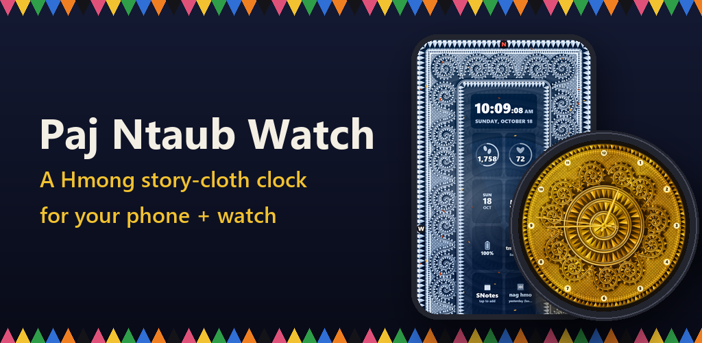

## Cultural context

*Paj ntaub* ("flower cloth") is the Hmong tradition of fine needlework: reverse appliqué, cross-stitch and embroidery in geometric motifs such as the snail-shell spiral (*qwj*), rows of triangles and stepped crosses. Story cloths are a later form that grew out of it. They are embroidered scenes that record village life and the Hmong journey across Laos, Thailand and the diaspora. The app recreates those motifs in code as a working clock, and it teaches a Hmong word every day.

## Status

- **Android phone: in Google Play closed testing** (version 1.2, closed "Alpha" track plus internal testing).
- **Wear OS watch: in Google Play closed testing** (its own "Watch Alpha" track). It installs from Play and runs on a Galaxy Watch6.
- Production release opens after Google's closed-testing period for new developer accounts. **iPhone is on hold.**

## Features

**The clock**
- **Five finishes:** Colour, Gold, Silver, Copper and Diamond. Every stitch, spiral and number changes with the finish, and Diamond adds raised gem stones and sparkles.
- **The real sun and moon** for your location. The sun turns deep orange-red at sunrise and sunset, the moon shows its real phase, and the embroidery's shadows fall away from whichever one is up. Solar eclipses darken the face.
- **Three phone layouts:** Standard (readings in tiles), Swipe (one big reading at a time) and Classic (a plain watch face in diamond or gold).
- **Phone and round-watch layouts from one engine.** A tall screen gets a full-screen rectangular story cloth. A round or square screen gets the circular face with 11 spirals. A phone can also choose the round look.
- Holidays from Hmong New Year to Christmas, with fireworks at midnight. Seasons and live weather animate across the cloth.

**Your day at a glance**
- **Steps and heart rate** from the phone's step counter and **Health Connect** (read only). There are step history views by day, week, month and year.
- **Live weather** from MET Norway: temperature, wind, a 12-hour outlook and several saved places. Leaves, rain, snow and clouds drift with the real wind speed and direction. **Offline, the last forecast is kept** and refreshed when the connection returns.
- Calendar appointments, alarms, timers and reminders, and **SNotes** (notes with photos and videos that show on the clock).
- **A Hmong word every day**, with a review of earlier words. The interface is in English and Hmoob.

**Step race**
- Start a race, set the winning step count (1,000, 5,000, 10,000 or a custom number) or a run of days, and share an invite link (`storyclothapp.com/join/?c=CODE` opens the app).
- Each person picks one of **13 animal racers** and moves round the spirals as they walk. You can send cheers, see the winners board, and collect history and trophies.
- Privacy by design: no accounts, emails, photos or location. A race stores only a join code, a display name, a colour and steps per day.

**Wear OS**
- A native **Watch Face Format** face in all five finishes, with the real sun and moon, the date for 5 seconds on each wrist raise, and a dim always-on mode.
- **Instant skin changes:** one face package holds every skin, and the companion app switches between them with a data update.
- Tap the middle for big readings (time, steps, heart rate, weather, battery), plus a "Check for updates" button that uses Play In-App Updates.

**Works on every phone**
- Every feature has a fallback. If there is no location, you can type a city. Without Health Connect, steps come from the phone. With no data, the rings are hidden. Without internet, the last weather stays. In a browser, Web APIs stand in for the native bridge.
- **Battery saver:** the clock draws at half the frame rate when the system Battery Saver is on or the battery is at 20% or less.
- **Accessibility:** larger text sizes, high contrast, and reduced motion that follows Android's "Remove animations" setting.
- Live wallpaper, screen saver and a home-screen widget all run the same clock.

**Business model**
- One month free, then a **one-time in-app purchase unlock** (Google Play Billing). There are no subscriptions and no ads. The unlock can be restored on a new phone.

## Tech stack

| Layer | Technology |
|---|---|
| Clock engine | A single-file **HTML5 Canvas** engine (vanilla JavaScript, about 6,500 lines, no framework) shared by every platform |
| Android phone app | **Java + Kotlin**, a full-screen `WebView` with a `@JavascriptInterface` bridge (`WatchApp`), Google Play Billing, Play In-App Updates, Health Connect client, exact alarms, `WallpaperService`, `DreamService`, `AppWidgetProvider`. minSdk 26, target SDK 37 |
| Wear OS | **Kotlin** companion app (skin picker, readings, complication data source) and a **Watch Face Format** face pushed with the Watch Face Push API |
| Art pipeline | **Python** (Pillow). The engine exports each skin's dial, hands and sun/moon artwork, and a script generates the WFF XML and resources |
| Step race API | **PHP 8 + SQLite** (WAL mode, prepared statements) behind **Caddy** (automatic HTTPS) on an Ubuntu VPS. It was first built as a Cloudflare Worker + D1 and migrated with the same API |
| Website | Static HTML/CSS at storyclothapp.com: landing page, how-to guide, privacy policy, support, data deletion and race-invite pages |
| Release tooling | Gradle (AGP 9), signed app bundles with Play App Signing, and a Python script that uses the Google Play Developer API to upload builds to testing tracks |

## Architecture

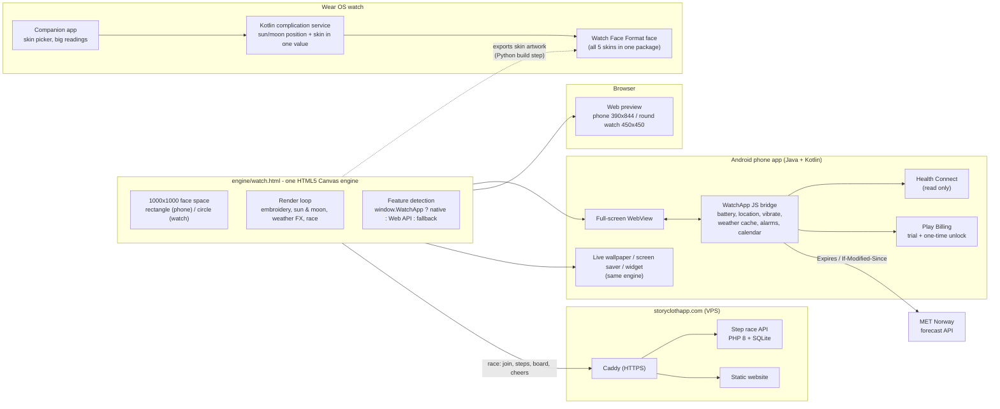

**How it fits together.** All drawing logic lives in one canvas engine. The Android app is a thin native host: it loads the engine into a WebView and exposes device features through the `WatchApp` bridge. The same file also runs the live wallpaper, the screen saver and the browser previews. Watch Face Format runs no code, so the engine *exports* its artwork for each skin and a Python build step turns that into the watch face. A small Kotlin complication service supplies the live data (sun and moon position, chosen skin) that the face can't work out itself. The only backend is the step race API, a small PHP + SQLite service behind Caddy.

## Engineering highlights

- **One engine, many screens.** About 6,500 lines of canvas code serve the phone (portrait and landscape), round and square watches, a live wallpaper, a screen saver and the web preview. Layout is chosen at runtime from the screen's aspect ratio. A shared `rpol(deg, r)` helper maps "round the clock" positions onto either a circle or a rectangle's perimeter, so features like the race track work in both layouts without separate code.
- **Shadows from the real sun and moon.** The engine computes solar and lunar altitude and azimuth for the user's location. Raised embroidery bands and thousands of 3D triangles cast shadows away from whichever is up. Shadows are longer when the light is low, softer under the moon (scaled by its phase) and fade during an eclipse. Shading uses cached colour variants and plain fills, with no canvas filters or gradients in the hot path.
- **A bridge that never blocks and never throws.** `@JavascriptInterface` calls return at once with plain strings or JSON. Slow work, like the forecast fetch, runs on a background thread while the engine polls (`"pending"`). Errors become sentinel values, so a missing sensor or permission never breaks the render loop.
- **Polite, offline-first weather client.** Each saved place has its own cache. The client never fetches before the server's `Expires` time, sends `If-Modified-Since` so an unchanged forecast costs only a 304, backs off for an hour on HTTP 429, and keeps the last forecast for offline use. The weather source was chosen to meet commercial licensing terms (MET Norway, CC BY 4.0).
- **Live data on a face that runs no code.** On Wear OS, Kotlin ports the engine's astronomy and packs the sun and moon positions plus the sun's height band into one integer complication value. The face decodes it with WFF expressions. The same slot's MAX selects the skin, which turned a multi-second face reinstall into a near-instant data update. If no data arrives, the face falls back to a clock-driven sun and moon.
- **Fixing a real-device concurrency bug.** On a Galaxy Watch, quick repeated taps during a skin change leaked service connections and left a stray face installed. I fixed it with an app-scoped coroutine, a single shared push manager, one change at a time, and retries with backoff. I then replaced the per-skin faces with the single-face design above.
- **Privacy by design.** The step race stores no accounts, emails, photos or location. Health data is read only and stays on the device. Settings, notes and photos stay on the phone, with user-controlled backup and restore.
- **A release pipeline I can run from one place.** Gradle builds signed app bundles. A Python script on the Google Play Developer API uploads to the phone and Wear OS testing tracks, and a separate build step generates the watch-face resources from the engine's artwork.

## Screenshots

| | | |
|---|---|---|
| 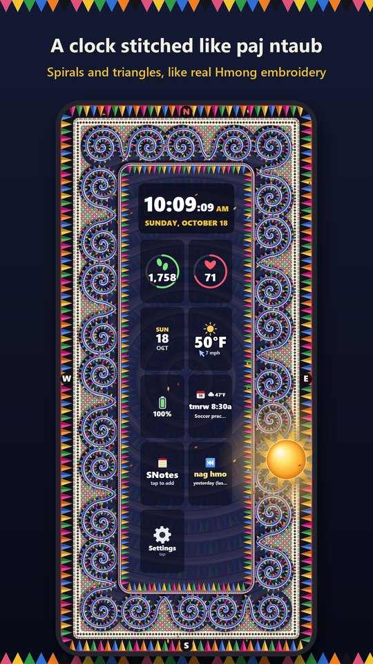 | 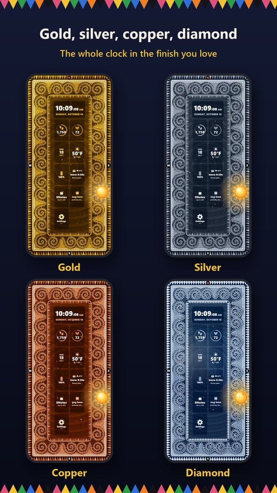 | 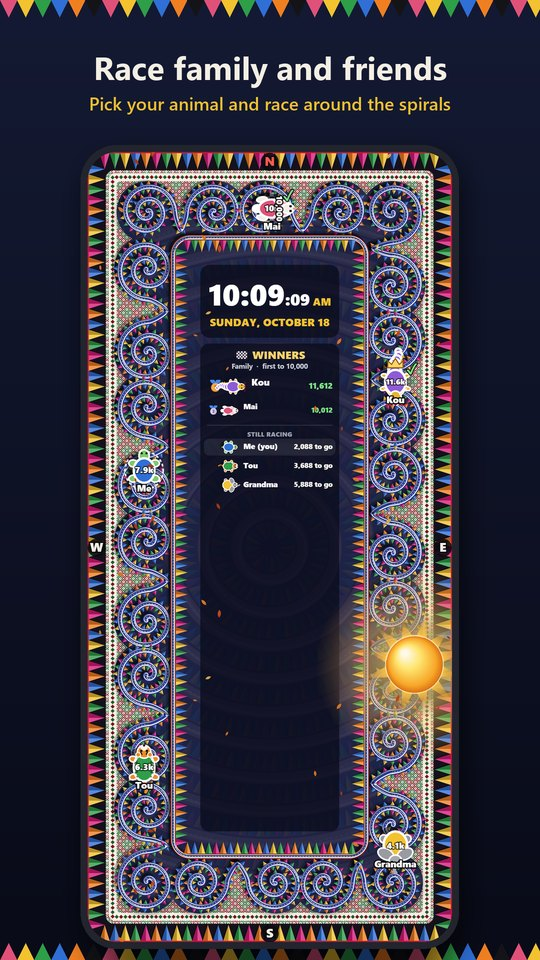 |
| Phone: the story-cloth clock with readings | Gold, Silver, Copper and Diamond finishes | Step race around the spirals |
| 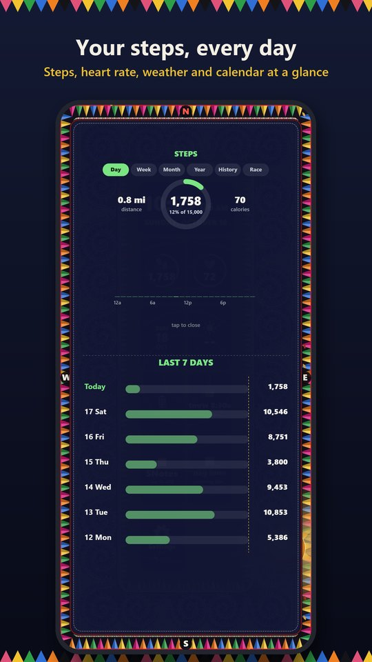 | 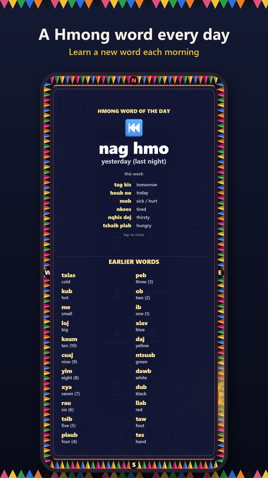 | 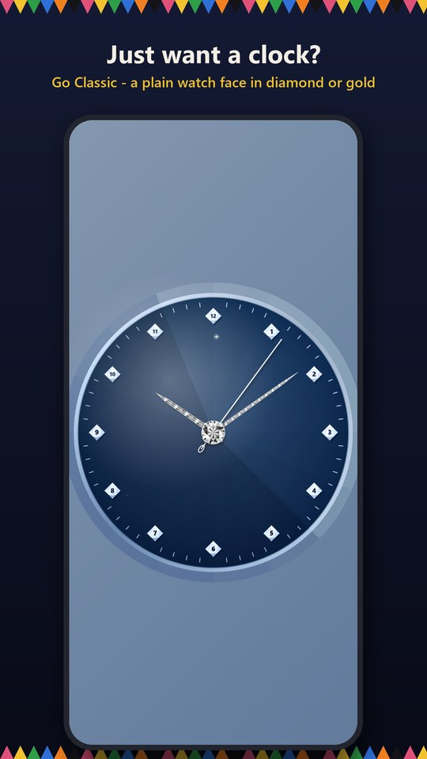 |
| Steps by day and week | A Hmong word every day | Classic: a plain watch face |
| 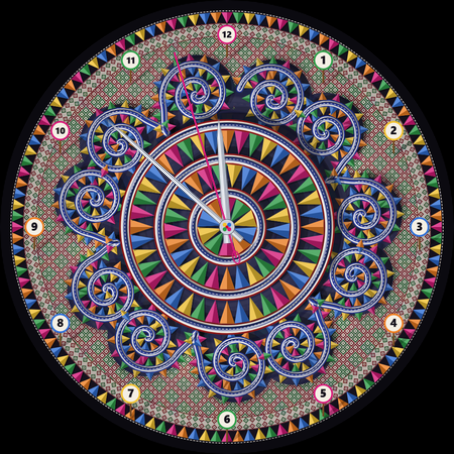 | 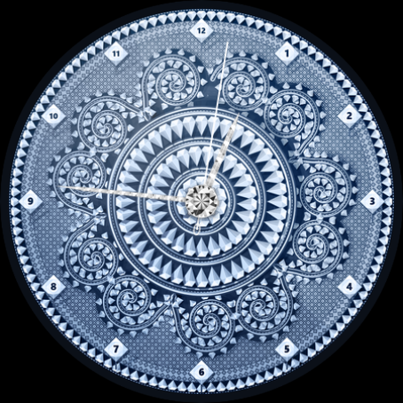 | 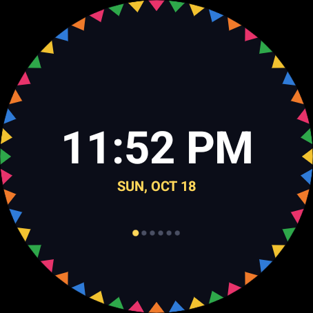 |
| Wear OS: Colour finish | Wear OS: Diamond finish | Wear OS: swipe-through readings |

## Code samples

Short, self-contained excerpts are in [`code-samples/`](code-samples/):

- [`engine-geometry-and-lighting.js`](code-samples/engine-geometry-and-lighting.js): the shared face space, rectangle and circle layout mapping, and embroidery lit by the real sun and moon.
- [`engine-feature-fallbacks.js`](code-samples/engine-feature-fallbacks.js): feature detection and fallbacks for battery, wake lock, vibration, motion, health data and offline weather.
- [`WatchAppBridge.java`](code-samples/WatchAppBridge.java): the Android `WatchApp` JavaScript bridge, including the cached, rate-limit-aware weather client.
- [`SkyComplication.kt`](code-samples/SkyComplication.kt): the Wear OS complication that feeds sun/moon positions and the chosen skin to a Watch Face Format face.

## Source code

**The full source is private. I'm happy to walk through it**: the engine, the Android and Wear OS apps, the step race service and the release tooling. Contact me through my GitHub profile or the support page at https://storyclothapp.com/support.html.

---

Copyright © 2026 Yang Pao Thao. All rights reserved. Shared for portfolio review only. See [LICENSE-NOTICE.md](LICENSE-NOTICE.md).
